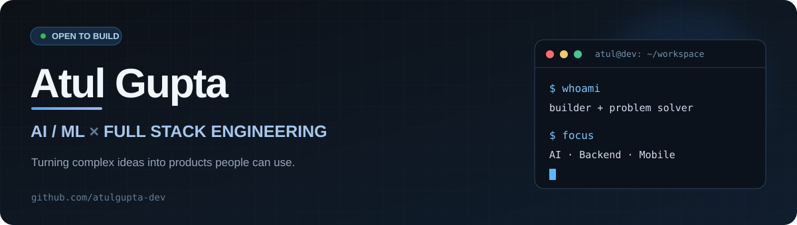

<div align="center">



<br />

<a href="https://github.com/atulgupta-dev"></a>
<a href="https://github.com/atulgupta-dev?tab=repositories"></a>


<br /><br />

**AI/ML • Full-stack engineering • Systems design**

<sub>Computer Science (Artificial Intelligence) · Chitkara University</sub>

</div>

---

### 

I build **intelligent, end-to-end products** — from interactive applications to robust backend systems. I'm interested in the intersection of **AI, product engineering, and scalable software architecture**.

```text
const focus = {
  build:   "Useful products with thoughtful UX",
  explore: "Artificial intelligence and machine learning",
  improve: "Backend engineering, DSA and system design"
};
```

### 

<div align="center">

**LANGUAGES**


**FRAMEWORKS & PLATFORMS**


**DATABASES & TOOLS**


<sub>Also exploring Apache Kafka, Gemini-powered applications and AI-assisted workflows.</sub>

</div>

---

### 

<table>
<tr>
<td width="50%" valign="top">

#### 01 · [Wallet Ledger](https://github.com/atulgupta-dev/wallet-ledger)

**High-throughput transaction architecture**

A double-entry wallet and ledger service built around concurrency, consistency, idempotency, and event-driven processing.

`Java` `Spring Boot` `PostgreSQL` `Redis` `Kafka`

<a href="https://github.com/atulgupta-dev/wallet-ledger"></a>

</td>
<td width="50%" valign="top">

#### 02 · [Acadly](https://github.com/atulgupta-dev/Acadly-Releases)

**Classroom technology · 700+ users**

An Android classroom-engagement app for attendance, polls, quizzes, Q&A, and lecture insights. **700+ users reported by creator.** Source code is private; public APK releases are available.

`Flutter` `Dart` `Android`

<a href="https://github.com/atulgupta-dev/Acadly-Releases/releases"></a>

</td>
</tr>
<tr>
<td width="50%" valign="top">

#### 03 · [CrediLink+](https://github.com/atulgupta-dev/CrediLink-)

**AI-enhanced learning & credentials**

A learning platform exploring tailored assessments, curated learning paths, and blockchain-verifiable certificates.

`Next.js` `TypeScript` `Firebase` `Web3`

<a href="https://github.com/atulgupta-dev/CrediLink-"></a>

</td>
<td width="50%" valign="top">

#### 04 · [SpashtAI](https://github.com/atulgupta-dev/spashtAi)

**Making insurance policies understandable**

An AI-powered insurance intelligence experience for analyzing policies, highlighting exclusions and comparing coverage.

`Next.js` `React` `Gemini` `Firebase`

<a href="https://github.com/atulgupta-dev/spashtAi"></a>

</td>
</tr>
<tr>
<td width="50%" valign="top">

#### 05 · [AGAM Docs](https://github.com/atulgupta-dev/AGAM-DOCS)

**Document conversion made simpler**

A full-stack conversion and merging workspace supporting common document and image formats.

`Django` `Next.js` `Python` `Docker`

<a href="https://github.com/atulgupta-dev/AGAM-DOCS"></a>

</td>
<td width="50%" valign="top">

#### 06 · [ThreatLens](https://github.com/atulgupta-dev/Threat-Lens)

**Cybersecurity dashboard prototype**

An interactive frontend concept featuring simulated breach-radar, password and domain-analysis experiences. **Simulation only; not a live threat-scanning service.**

`React` `Vite` `JavaScript`

<a href="https://github.com/atulgupta-dev/Threat-Lens"></a>

</td>
</tr>
</table>

---

### 

<div align="center">

**Explore the work, not just the numbers.**

<a href="https://github.com/atulgupta-dev?tab=overview"></a>
<a href="https://github.com/atulgupta-dev?tab=repositories"></a>

<sub>My actual contribution calendar and public code are available on GitHub. No third-party generated stats screenshots or unstable trophy services.</sub>

</div>

### 

**DSA & problem solving** · Practicing efficient algorithms in **Java**.

<a href="https://github.com/atulgupta-dev/Leetcode-solutions"></a>

<sub>Solutions repository is currently empty; no invented solved counts or rankings.</sub>

---

<div align="center">

### Let's build things that matter.

*Clean engineering. Thoughtful design. Real-world impact.*

<a href="https://github.com/atulgupta-dev?tab=repositories"></a>

<sub>Made with curiosity, code, and many iterations.</sub>

</div>
